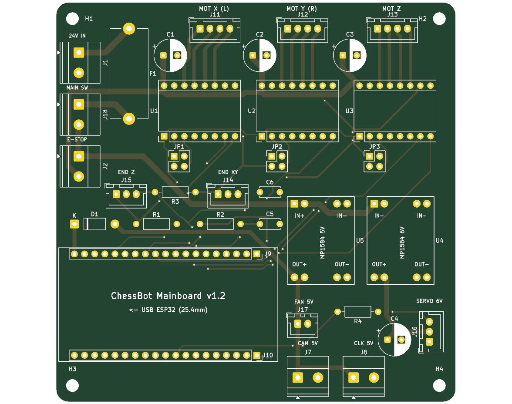
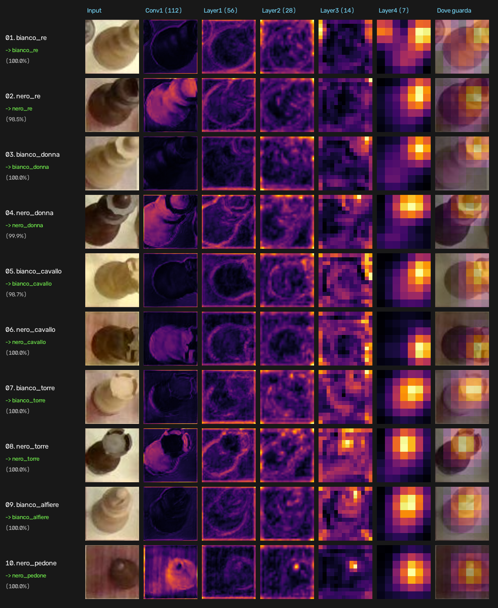

# ChessBotOs

**End-to-end autonomous physical chess-playing robot** combining a custom 3D-printed **5-bar parallel SCARA manipulator**, **deep-learning computer vision (ResNet-18 + ArUco)**, **Stockfish chess engine**, **distributed ESP32 firmware**, and a **custom 2-layer KiCad mainboard PCB**.


---

## Highlights

- **5-Bar Parallel SCARA Kinematics:** Analytical inverse kinematics (`a = 183 mm`, `b = 230 mm`, `16T:100T` belt reduction) ported from Python (`IK.py`) to real-time ESP32 C++ (`scara_ik.ino`) with trapezoidal acceleration ramps and **~1.6 mm RMS positional accuracy** calibrated across 35 measured board points.
- **2-Stage Computer Vision Pipeline:** Overhead **ESP32-S3 + OV5640** autofocus camera stream with 1:1 hardware crop, **ArUco homography** board warping (`800×800` → 64 cells), and dual **PyTorch ResNet-18** models (3-class occupancy/color + 13-class full piece classification) with Class Activation Map (CAM) interpretability.
- **Custom 2-Layer Mainboard PCB:** Designed from scratch in **KiCad 10.0** (`100 × 100 mm`, **0 DRC errors**, **0 unconnected pads**), integrating an ESP32 38-pin controller, 3× **TMC2209** stepper drivers, dual **MP1584EN** buck rails (5V logic + 6V 25 kg gripper servo), NC hardware E-Stop cutting motor power only (`VMOT_24V`), 5A fuse, and unified JST-XH connectors.
- **3D-Printed Mechanics & Clock Console:** Full PETG + 2020 aluminum extrusion robot CAD (`ChessBot_checkpoint_4.blend`) and a dedicated touchscreen **Chess Clock Console** (`ChessBot_ClockConsole.blend`) housing an ESP32-S3 4.0" IPS capacitive display and a mechanical MX top switch.

---

## Visual Showcase

<table>
  <tr>
    <td align="center" width="52%">
      
      <br />
      <sub><b>Custom 2-Layer Mainboard PCB v1.2</b> (100×100 mm, KiCad 10.0 — 3× TMC2209, ESP32, dual MP1584EN, E-Stop)</sub>
    </td>
    <td align="center" width="48%">
      
      <br />
      <sub><b>ResNet-18 Piece Classifier</b> — Conv1 feature maps & Layer4 Class Activation Maps across piece classes</sub>
    </td>
  </tr>
</table>

---

## System Architecture

```mermaid
flowchart LR
    subgraph HOST["Host PC (Python · PyTorch · Stockfish)"]
        CV["ArUco Warp + ResNet-18\n(3-class & 13-class)"]
        ENG["Stockfish Engine\n& Game Orchestrator"]
        CV --> ENG
    end

    subgraph CAM["Overhead Vision Node"]
        ESP_CAM["ESP32-S3 + OV5640\n(1:1 Square Stream + AF)"]
    end

    subgraph MOTION["Mainboard PCB v1.2 (24V / 6V / 5V)"]
        ESP_MOT["ESP32 38-pin\n5-Bar SCARA IK + Z-Axis"]
        DRV["3x TMC2209 + NEMA 17\n+ 25 kg Gripper Servo"]
        ESP_MOT --> DRV
    end

    subgraph HMI["Clock Console (3D Printed)"]
        CLK["ESP32-S3 4.0\" IPS Touch\n+ Mechanical MX Button"]
    end

    ESP_CAM -- "HTTP / Wi-Fi" --> CV
    ENG -- "Move Commands" --> ESP_MOT
    ENG <--> |"Clock & UX State"| CLK
```

---

## Repository Structure

```text
ChessBotOs/
├── README.md
├── .gitignore
├── 3Dmodel/                                    # Blender CAD models
│   ├── ChessBot_checkpoint_4.blend             # Full 5-bar SCARA robot assembly (2020 frame + PETG parts)
│   └── ChessBot_ClockConsole.blend             # 3D-printable 4.0" IPS touch clock console + MX switch
├── hardware/
│   └── mainboard_pcb/                          # Custom 2-layer KiCad 10.0 Mainboard v1.2 (100x100 mm)
│       ├── Motherboard_chessbot.kicad_pro
│       ├── Motherboard_chessbot.kicad_sch      # Full schematic (0 ERC errors)
│       ├── Motherboard_chessbot.kicad_pcb      # Routed 2-layer PCB (0 DRC errors, solid B.Cu GND plane)
│       ├── ChessBot_Local.pretty/              # Custom STEP-verified MP1584EN footprint
│       ├── gerbers/                            # Production-ready Gerber + Excellon drill ZIP
│       └── ChessBot_Mainboard_v1.2_PrintCheck_1to1.pdf
├── docs/                                       # Engineering specs, BOM & hardware guides (Italian)
│   ├── riassunto_progetto_chessbot.md          # Complete project & mechatronics overview
│   ├── specifiche_funzionali_chessbot.md       # Functional specs, UX flows & Fair Clock logic
│   ├── bom_componenti_chessbot.md              # Bill of Materials aligned with CAD & PCB
│   ├── guida_pcb_kicad_chessbot.md             # PCB design & assembly guide
│   └── images/                                 # PCB 3D renders
└── test/                                       # Prototype modules & validation tools
    ├── InverseKinematic/
    │   └── IK.py                               # Analytical 5-bar parallel SCARA inverse kinematics
    ├── scara_ik/
    │   └── scara_ik.ino                        # ESP32 C++ IK firmware + serial CLI (a1..h8, z±mm, home)
    ├── stepper/
    │   └── stepper.ino                         # Stepper & microstepping bring-up test
    ├── pinzaInput/                             # Gripper servo actuation test
    ├── esp32_cam_stream/                       # ESP32-S3 (N16R8 + OV5640) web stream + autofocus firmware
    ├── aruco_markers/                          # ArUco marker generator & 800x800 perspective warp
    ├── dataset_tools/                          # Capture, 3/13-class labeling, smart collection & label review
    ├── resnet18/                               # PyTorch ResNet-18 training, live inference & CAM visualizations
    └── stockfish/                              # Stockfish engine integration test
```

---

## Subsystems & Quick Start

### 1. 5-Bar SCARA Kinematics & Motion Control (`test/InverseKinematic`, `test/scara_ik`)
- **Python prototype (`test/InverseKinematic/IK.py`):** Solves left/right shoulder angles `(θ_L, θ_R)` for any `(x, y)` coordinate or chess square (`a1`–`h8`), `home`, and `cemetery` discard zone.
- **ESP32 firmware (`test/scara_ik/scara_ik.ino`):** Real-time coordinated L/R + Z-axis (`T8×8`, `1:3` reduction) motion with trapezoidal velocity ramps and an interactive `115200` baud serial monitor:
  - Squares: `a1` .. `h8` (e.g. `e4`, `a8`)
  - Special targets: `home`, `cemetery`, direct `x,y` coordinates
  - Z-axis: relative `z+10` / `z-10` or absolute `z0` / `z20`
  - Telemetry: `pos` or `?`

### 2. ESP32-S3 Overhead Camera (`test/esp32_cam_stream`)
Firmware for **Goouuu ESP32-S3-N16R8** with **OV5640** sensor:
- Copy `credentials.example.h` → `credentials.h` (git-ignored) and set your Wi-Fi SSID/password. Falls back automatically to the `ESP32S3-CAM` access point (`192.168.4.1`).
- Hardware-cropped **1:1 square resolutions** (`1500×1500`, `1024×1024`, `800×800`) and OV5640 VCM autofocus support (`ESP32_OV5640_AF`).

### 3. ArUco Calibration & Dataset Pipeline (`test/aruco_markers`, `test/dataset_tools`)
Recommended Python environment (`conda activate chess_bot` with `opencv-python`, `numpy`, `torch`, `torchvision`, `pillow`):
```powershell
# 1. Verify ArUco perspective warp (800x800 chessboard grid)
python test/aruco_markers/MakerIdentification.py

# 2. Capture 64 cells (100x100 px) per shot (SPACE to capture, Q to quit)
python test/dataset_tools/DatasetCollector.py

# 3. Label 3-class (occupancy/color) or 13-class (piece types)
python test/dataset_tools/DatasetLabeler.py
python test/dataset_tools/PieceLabeler.py
```
Additional active-learning helpers: `SmartPieceCollector.py` (auto-filters empty squares with the 3-class model), `TargetedPieceCollector.py` (single-piece capture), and `ReviewLabels.py` (error/imbalance auditing).

### 4. ResNet-18 Piece Recognition (`test/resnet18`)
```powershell
# Train on CUDA (3-class and 13-class)
python test/resnet18/train_resnet18.py
python test/resnet18/train_resnet18_pieces.py

# Live camera inference
python test/resnet18/infer_live.py
python test/resnet18/infer_live_pieces.py

# Generate Conv1..Layer4 activation & CAM visualizations
python test/resnet18/visualize_resnet_layers.py
```

### 5. Custom Mainboard PCB (`hardware/mainboard_pcb`)
- **Board:** `100 × 100 mm`, 2 layers, 1 oz Cu, THT + socketed modules (production-ready for JLCPCB / PCBWay).
- **Power rails:** 24V input → 5A fuse (`F1`) → Main Switch (`J18`) → NC E-Stop (`J2`, cuts `VMOT_24V` only so logic stays alive) + dual `MP1584EN` buck converters (`5.0 V` logic/camera/clock/fan, `6.0 V` gripper servo).
- **Manufacturing package:** Ready-to-upload Gerber + Excellon drill archive in [`hardware/mainboard_pcb/gerbers/`](hardware/mainboard_pcb/gerbers/ChessBot_Mainboard_v1.2_PCBWay.zip) and a 1:1 A4 paper fit-check PDF in [`hardware/mainboard_pcb/`](hardware/mainboard_pcb/ChessBot_Mainboard_v1.2_PrintCheck_1to1.pdf).

---

## Project Status & Roadmap

- [x] 3D-printed 5-bar parallel SCARA mechanical design & working physical prototype
- [x] Analytical inverse kinematics (Python & ESP32 C++) calibrated to ~1.6 mm RMS
- [x] ESP32-S3 OV5640 streaming + ArUco homography board extraction
- [x] Custom dataset pipeline + trained 3-class & 13-class ResNet-18 models with CAM visualizations
- [x] Functional specifications, BOM, and 3D-printable 4.0" IPS Clock Console CAD
- [x] Custom 2-layer KiCad 10.0 Mainboard PCB (0 ERC/DRC errors, Gerbers ready for fabrication)
- [ ] PCB assembly & hardware bring-up with TMC2209 silent drivers + endstop homing
- [ ] Unified game orchestrator (`ChessBotOs` host + Stockfish + Fair Clock + auto-setup)
- [ ] ESP32-S3 4.0" LVGL Clock Console UI & Wi-Fi telemetry

---

## Excluded from Git (`.gitignore`)

- `credentials.h` and local secrets
- `datasets/` (raw captured board images and CSV labels)
- `stockfish-windows-x86-64-universal/` (local Stockfish binary > 100 MB)
- KiCad / Blender lockfiles and auto-backups
